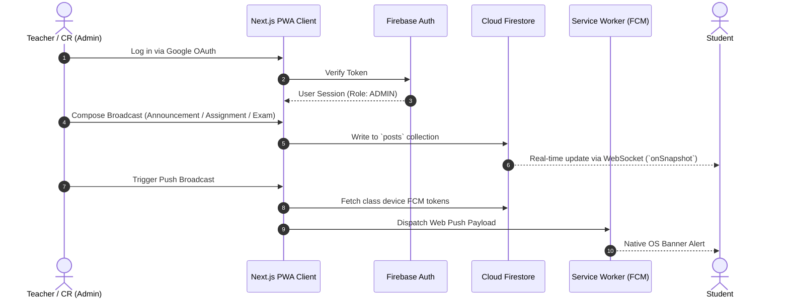

# ClassSync — Master Technical & System Documentation

> Comprehensive reference guide covering application architecture, design systems, data models, PWA specifications, and deployment workflows for **ClassSync**.

---

## 1. Executive Summary & Vision

**ClassSync** is an offline-capable, Progressive Web App engineered to modernize classroom communication. Designed for universities, colleges, and training academies, it consolidates announcements, deadline tracking, schedules, lecture materials, and student celebrations into a cohesive, distraction-free environment.

### Core Objectives
1. **Zero Missed Deadlines:** Urgency-colored broadcast cards with built-in countdown timers and daily automated web push digests.
2. **Offline Resilience:** Service-worker caching strategy ensures timetables, notes, and previous broadcasts remain readable even without internet connectivity.
3. **Cross-Platform Accessibility:** Functions identically across Android, iOS (Safari 16.4+ Web Push), macOS, Windows, and Linux via PWA installation.
4. **Zero Operational Overhead:** Built entirely on free-tier services (Firebase Spark Plan, Vercel Edge Serverless, GitHub Actions).

---

## 2. Design System & Aesthetics

### 2.1 Brand Identity & Colors
- **Brand Squircle:** Emerald-to-teal linear gradient (`#047857` ➔ `#059669` ➔ `#0d9488`) with high-contrast white vector icons.
- **Wordmark Typography:** Strict two-tone hierarchy:
  - Base: `Class` in high-contrast neutral (`text-stone-900` / `text-white`)
  - Accent: `Sync` in emerald brand tone (`text-emerald-700` / `text-emerald-400`)

### 2.2 Color Palettes

| Token | Light Theme (Forest Sage) | Dark Theme (Midnight Forest) |
| :--- | :--- | :--- |
| **Canvas Background** | `#dfe8df` | `#09130e` |
| **Card Surface** | `rgba(255, 255, 255, 0.88)` | `#121c16` |
| **Elevated Surface** | `#ffffff` | `#16231b` |
| **Border Accent** | `#e7e5e4` (`stone-200`) | `#1e3025` |
| **Primary Text** | `#1c1917` (`stone-900`) | `#ffffff` |
| **Secondary Text** | `#78716c` (`stone-500`) | `#a8a29e` (`stone-400`) |
| **Brand Accent** | `#047857` (`emerald-700`) | `#34d399` (`emerald-400`) |

---

## 3. Architecture & Data Flow



---

## 4. Key Functional Modules

### 4.1 Broadcast Composer & Feeds
- **Anti-Overflow Radio Controls:** 3-button responsive layout with dedicated icons (`Bell` for Announcement, `FileText` for Assignment, `AlertCircle` for Exam).
- **Auto-Expiration:** When a deadline passes, the post automatically clears from active feeds.
- **Live Student Preview:** Admin dashboard includes a real-time mirror of the student panel.

### 4.2 Timetable System
- Day-based tabs (Mon–Sat) with start/end time, subject title, teacher, and venue.
- Full PDF preview modal and direct download links for the institutional master timetable.

### 4.3 Subject & Resources Management
- Hierarchical storage: `Classes` ➔ `Subjects` ➔ `Materials`.
- Tagged resource types: *Syllabus*, *Notes*, *Reference Links*, *Question Papers*.
- Admin permission checks on subject addition, renaming, and link deletion.

### 4.4 Birthday Celebration Engine
- Daily automated spotlight showcasing today's celebrating students with confetti animations.
- Proactive alerts for birthdays arriving tomorrow.
- Searchable month-by-month directory for the entire academic batch.
- Admin push trigger for instant class-wide celebration notifications.

### 4.5 Slide-Over Settings & Profile Drawer
- Real-time profile photo, phone number, and gender update modal (name & email immutable for security).
- 3-way segmented theme switcher: Light / Dark / Auto (System).
- FCM push notification toggle with live permission status.
- PWA service worker offline readiness indicator.

---

## 5. Security Architecture & RBAC

Role-Based Access Control is enforced at both the client and database layers:

```
                  ┌────────────────────────┐
                  │ Google Authenticated   │
                  │ User                   │
                  └───────────┬────────────┘
                              │
                    Role == "ADMIN"?
                   /                \
                 YES                 NO
                 /                    \
    ┌──────────────────────┐  ┌──────────────────────┐
    │  Admin Capabilities  │  │ Student Capabilities │
    │                      │  │                      │
    │ - Compose Broadcasts │  │ - View Broadcasts    │
    │ - Edit / Delete Posts│  │ - Filter by Category │
    │ - Manage Class Codes │  │ - Switch Classes     │
    │ - Manage Subjects    │  │ - Download Materials │
    │ - Trigger FCM Alerts │  │ - View Timetables    │
    │ - Broadcast Birthdays│  │ - View Birthday List │
    └──────────────────────┘  └──────────────────────┘
```

---

## 6. Firestore Collections Reference

### `users`
- `uid` *(string)*: Unique Firebase Authentication UID.
- `displayName` *(string)*: Full student/teacher name.
- `email` *(string)*: Google account email.
- `role` *(string)*: `"STUDENT"` | `"ADMIN"`.
- `enrolledClassCode` *(string)*: Active class identifier (e.g. `"MCA-2026"`).
- `enrolledClasses` *(array<string>)*: History of all joined classes.
- `fcmTokens` *(array<string>)*: Active device push notification tokens.
- `remindersEnabled` *(boolean)*: Notification preference.

### `posts`
- `id` *(string)*: Auto-generated document ID.
- `title` *(string)*: Broadcast headline.
- `description` *(string)*: Detailed text content.
- `type` *(string)*: `"ANNOUNCEMENT"` | `"ASSIGNMENT"` | `"EXAM"`.
- `classCode` *(string)*: Target class identifier.
- `dueDate` *(Timestamp, optional)*: Due/expiration timestamp.
- `createdAt` *(Timestamp)*: Creation timestamp.
- `createdBy` *(string)*: Admin UID.

### `subjects` & `materials`
- `subjects`: Documents containing `name` and `classCode`.
- `materials`: Documents referencing `subjectId`, with `title`, `category`, `fileUrl`, and `fileName`.

---

## 7. Progressive Web App (PWA) Specification

1. **Manifest Configuration (`public/manifest.json`):**
   - Theme color: `#047857` (Emerald Brand)
   - Background color: `#09130e` (Midnight Forest Canvas)
   - Display: `standalone`
   - Orientation: `portrait-primary`
2. **Icon Assets:**
   - Standard: `icon-192x192.png`, `icon-512x512.png`
   - Maskable: `icon-maskable-512x512.png` (80% safe zone centered for Android adaptive masks)
   - iOS: `apple-touch-icon.png` (180x180)
   - Favicons: `src/app/icon.png`, `src/app/apple-icon.png`, `public/favicon-32x32.png`

---

## 8. Verification & Build Commands

```bash
# Development Server
npm run dev

# TypeScript & Production Build Verification
npm run build

# Start Production Server
npm run start
```
